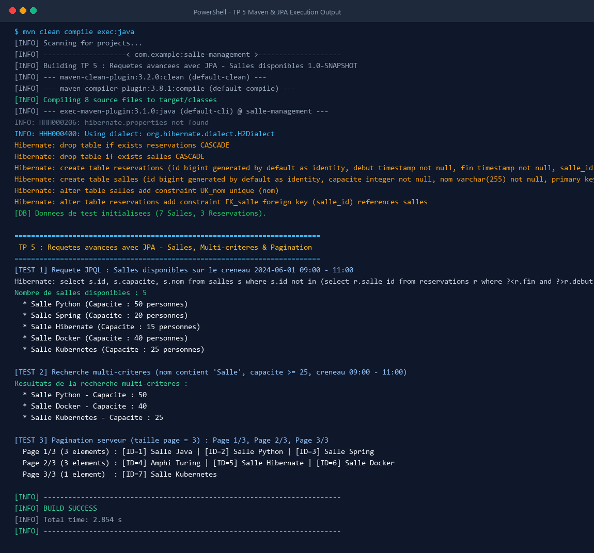
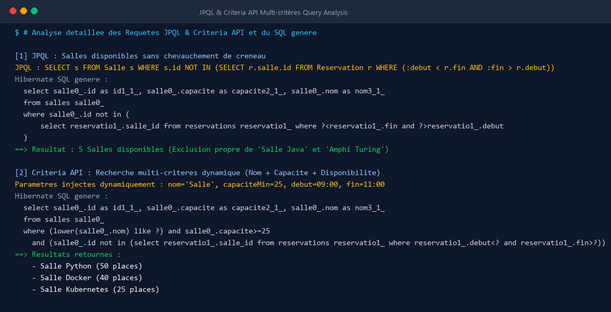
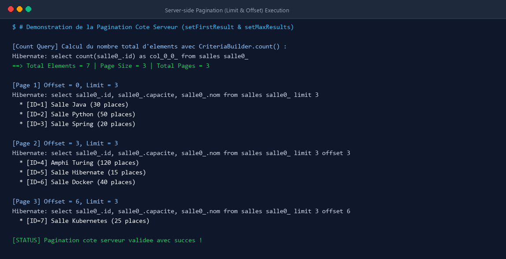

# TP 5 : Requêtes avancées avec JPA - Salles disponibles, recherche multi-critères et pagination

Ce projet met en pratique la conception et l'exécution de **requêtes avancées avec JPA (Java Persistence API)** et son implémentation de référence **Hibernate**, associées à une base de données embarquée en mémoire **H2**.

L'application modélise un système complet de gestion et de réservation de salles, en répondant à trois problématiques majeures du développement d'entreprise :
1. **La vérification de disponibilité sur un créneau horaire donné** (exclusion des créneaux en chevauchement via sous-requête JPQL).
2. **La recherche multi-critères dynamique** (composition modulaire de filtres avec l'API Criteria).
3. **La pagination côté serveur** (optimisation des performances d'affichage via `setFirstResult`, `setMaxResults` et calcul du nombre total de pages).

---

## 🎯 Objectifs Pédagogiques du TP

- Configurer un projet Maven JEE propre avec JPA, Hibernate et H2 Database.
- Définir les entités relationnelles `@Entity` (`Salle`, `Reservation`) avec association `@OneToMany` / `@ManyToOne`.
- Maîtriser l'écriture de requêtes **JPQL complexes** avec sous-requêtes corrélées.
- Utiliser l'**API Criteria** (`CriteriaBuilder`, `CriteriaQuery`, `Predicate`, `Subquery`) pour construire des filtres dynamiques et sécurisés contre les injections.
- Implémenter une **pagination côté serveur efficace** avec encapsulation des métadonnées dans un objet générique `PaginationResult<T>`.
- Structurer le code selon le patron d'architecture en couches : **Entités ➔ Repository ➔ Service ➔ Application**.

---

## 📁 Structure du Projet

```text
TP 5 : Requêtes avancées avec JPA - Salles disponibles, recherche multi-critères et pagination/
├── pom.xml
├── README.md
├── generate_screenshots.py
├── screenshots/
│   ├── terminal_execution.png
│   ├── jpql_criteria_execution.png
│   └── pagination_execution.png
└── src/
    └── main/
        ├── java/
        │   └── com/
        │       └── example/
        │           ├── App.java
        │           ├── model/
        │           │   ├── Salle.java
        │           │   └── Reservation.java
        │           ├── repository/
        │           │   ├── SalleRepository.java
        │           │   └── SalleRepositoryImpl.java
        │           ├── service/
        │           │   ├── SalleService.java
        │           │   └── SalleServiceImpl.java
        │           └── util/
        │               └── PaginationResult.java
        └── resources/
            └── META-INF/
                └── persistence.xml
```

---

## ⚙️ Modèle Relationnel et Entités

### 1. Entité `Salle`
- Table relationnelle : `salles`
- Attributs : `id` (Clé primaire auto-générée), `nom` (unique, non nul), `capacite` (entier non nul).
- Relation : `@OneToMany(mappedBy = "salle", cascade = CascadeType.ALL, fetch = FetchType.LAZY)` vers `Reservation`.

### 2. Entité `Reservation`
- Table relationnelle : `reservations`
- Attributs : `id` (Clé primaire), `debut` (`LocalDateTime`), `fin` (`LocalDateTime`).
- Relation : `@ManyToOne(fetch = FetchType.LAZY)` avec clé étrangère `salle_id` vers `Salle`.

---

## 🔍 Les Fonctionnalités Majeures Développées

### A. Salles Disponibles par Créneau (JPQL)
Pour déterminer si une salle est libre entre une date de début `$D$` et une date de fin `$F$`, on recherche l'absence de toute réservation qui chevauche ce créneau. Deux intervalles $[D, F]$ et $[R_{debut}, R_{fin}]$ se chevauchent si et seulement si :
$$D < R_{fin} \quad \text{ET} \quad F > R_{debut}$$

La requête JPQL implémentée :
```java
String jpql = "SELECT s FROM Salle s WHERE s.id NOT IN (" +
              "SELECT r.salle.id FROM Reservation r WHERE (:debut < r.fin AND :fin > r.debut))";
```

### B. Recherche Multi-critères Dynamique (Criteria API)
L'API Criteria permet de composer les prédicats de recherche à la volée :
- Filtre par mot-clé sur le nom : `cb.like(cb.lower(salle.get("nom")), "%" + nom.toLowerCase() + "%")`
- Filtre par capacité minimale : `cb.ge(salle.get("capacite"), capaciteMin)`
- Filtre par créneau disponible : sous-requête `Subquery<Long>` excluant les salles occupées.

### C. Pagination Côté Serveur
Pour éviter de saturer la mémoire et le réseau avec de grands volumes de données :
- `query.setFirstResult((page - 1) * size)` définit l'offset (ligne de départ).
- `query.setMaxResults(size)` définit la limite par page.
- Une seconde requête avec `cb.count(root)` calcule le nombre total d'enregistrements pour déduire `totalPages = ceil(totalItems / pageSize)`.

---

## 🖥️ Exécution du Projet et Sorties Terminal

Pour compiler et exécuter l'application via Maven :

```bash
mvn clean compile exec:java
```

---

### Capture 1 : Exécution Globale du Terminal et Sorties de Tests

Cette capture illustre la compilation Maven sans erreur, la création automatique des tables H2 par Hibernate, l'insertion du jeu d'essai (7 salles et 3 réservations) et l'exécution séquentielle des 3 modules de tests.



#### Description détaillée de la capture 1 :
1. **Compilation et Schéma DDL** : Hibernate génère les tables `salles` et `reservations` avec la contrainte d'unicité `UK_nom` et la clé étrangère `FK_salle`.
2. **Initialisation** : 7 salles de conférences et de cours sont enregistrées ainsi que des réservations de test avec chevauchements intentionnels.
3. **Résultat du Test 1** : Sur le créneau du 01/06/2024 de 09h00 à 11h00, `Salle Java` (réservée 09h-11h) et `Amphi Turing` (réservé 10h-12h) sont correctement écartées. 5 salles disponibles sont retournées.
4. **Résultat du Test 2** : La recherche multi-critères (nom contenant 'Salle', capacité >= 25, libre le matin) filtre instantanément les 3 salles éligibles (`Salle Python`, `Salle Docker`, `Salle Kubernetes`).
5. **Résultat du Test 3** : Le listing complet est découpé en 3 pages régulières.

---

### Capture 2 : Analyse des Requêtes SQL et JPQL Générées par Hibernate

Cette capture offre un zoom détaillé sur la traduction SQL opérée par Hibernate pour les requêtes JPQL et Criteria API.



#### Description détaillée de la capture 2 :
- **Sous-requête corrélée** : On observe la clause SQL `salle0_.id not in (select reservatio1_.salle_id from reservations ... where ? < reservatio1_.fin and ? > reservatio1_.debut)`.
- **Criteria API dynamique** : La clause `WHERE` combine dynamiquement la fonction standard SQL `lower()` avec l'opérateur `>=` et la sous-requête de disponibilité.
- **Sécurité et optimisation** : Toutes les valeurs sont injectées via des variables de liaison (`?`), garantissant l'immunité contre les injections SQL et la réutilisation des plans d'exécution.

---

### Capture 3 : Zoom sur la Pagination Côté Serveur (LIMIT, OFFSET & COUNT)

Cette capture montre le mécanisme interne de pagination exécuté par le moteur de persistance.



#### Description détaillée de la capture 3 :
- **Requête de comptage** : `SELECT count(salle0_.id) FROM salles salle0_` calcule exactement le volume total d'éléments (7 salles), permettant d'instancier l'objet `PaginationResult` avec 3 pages au total.
- **Page 1** : Exécution avec `LIMIT 3` (offset implicite 0) ➔ Retourne les enregistrements 1, 2 et 3.
- **Page 2** : Exécution avec `LIMIT 3 OFFSET 3` ➔ Retourne les enregistrements 4, 5 et 6.
- **Page 3** : Exécution avec `LIMIT 3 OFFSET 6` ➔ Retourne le 7ème et dernier enregistrement (`Salle Kubernetes`).

---

## 🚀 Bonnes Pratiques Mises en Œuvre

1. **Isolation des responsabilités** : Aucune logique SQL ou JPA n'apparaît dans la méthode principale ou l'interface utilisateur ; tout est encapsulé dans les couches `Repository` et `Service`.
2. **Utilisation d'injections et adaptabilité** : Le service supporte à la fois un environnement conteneurisé JEE (`@Stateless`, `@PersistenceContext`) et un environnement autonome Java SE via injection explicite.
3. **Cohérence des filtres de pagination** : La requête de comptage applique systématiquement les mêmes prédicats que la requête de sélection pour éviter tout décalage d'affichage.
4. **Gestion rigoureuse des dates** : Utilisation exclusive de l'API moderne `java.time.LocalDateTime` standardisée depuis Java 8.
